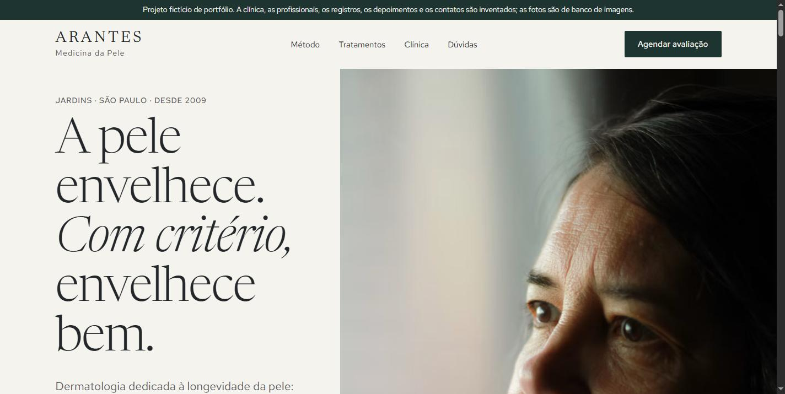
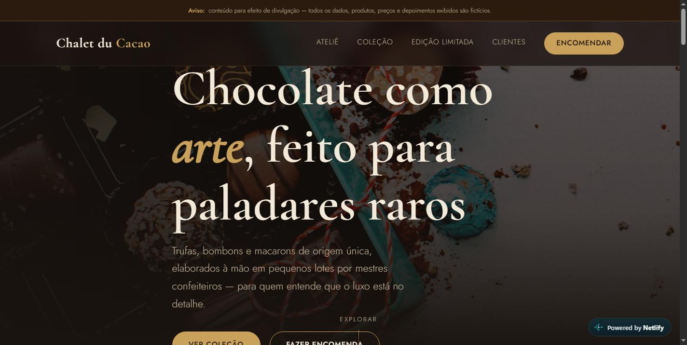

# Hans Claudio — Web Developer

I build fast, responsive websites for small businesses: institutional sites, landing pages and e-commerce / affiliate marketplaces. Stack: **Next.js, React, TypeScript, Tailwind CSS, Node.js (NestJS), PostgreSQL (Prisma)**, plus plain HTML/CSS when that is the better tool.

Based in Brazil (UTC−3). Portuguese (native) and English.

## Portfolio

Everything below is **my own work**: demo sites I designed and built to show what I can deliver, and two products I run. None of it is client work. Demo content is fictional.

| | Project | What it is | Stack | Links |
|---|---|---|---|---|
|  | **Boxer Atelier** | Premium one-page site for an automotive atelier, with cinematic scroll animations | Next.js 16, TypeScript, Tailwind 4, GSAP, Framer Motion | [Live demo](https://boxer.zevro.app) · [Source](https://github.com/Integrius/boxer-atelier-demo) |
|  | **Arantes** | Landing page for a dermatology clinic: trust-focused copy, FAQ, privacy page, schema.org SEO | HTML, CSS, JavaScript | [Live demo](https://arantesdermato.zevro.app) · [Source](https://github.com/Integrius/arantesdermato) |
|  | **Chalet du Cacao** | Mobile-first site for an artisan confectionery, CSS-only interactions | HTML, CSS | [Live demo](https://chaletducacao.netlify.app) · [Source](https://github.com/Integrius/chalet-du-cacao-demo) |
|  | **Aurum** | Aesthetic clinic site template with a content/database layer and authentication | Next.js, React, Prisma, NextAuth, Framer Motion | [Live demo](https://beauty.zevro.app) · Source on request |

### Own products (code private)

- **[Gertrude](https://gertrude.com.br)** — fashion affiliate marketplace, built end to end. Monorepo with a Next.js storefront and admin panel, a NestJS API and PostgreSQL via Prisma, all in TypeScript.
- **[Vivoly](https://vivoly.com.br)** — sports and running affiliate marketplace on the same architecture.

## Working with me

Send me your idea and I will tell you honestly how I can help. I reply clearly, deliver on schedule and keep you updated at every step. Find me on Upwork as **Hans Claudio D.**
